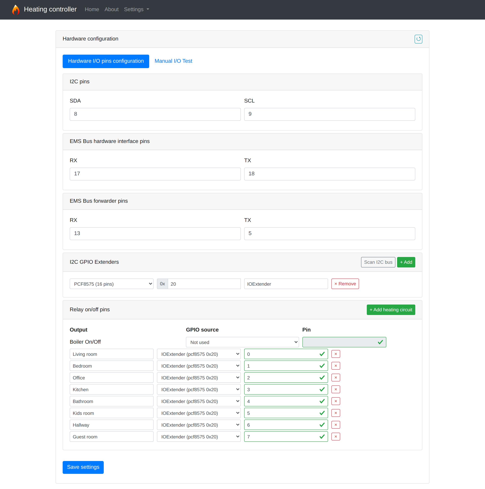
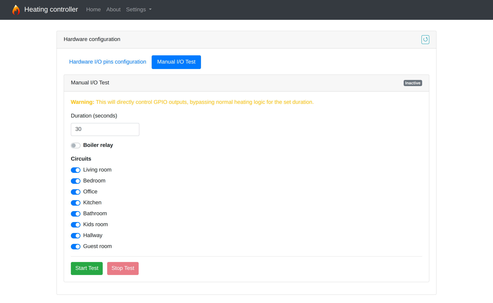

# Heating circuits, valves and I/O expanders

A **heating circuit** is a configured output controlling an actuator or relay.
A **room** associates a temperature sensor with one or more of those outputs.
A **program** defines the room's temperature schedule. Configure these in that
order: hardware outputs, room assignments, then program settings.

Outputs can use ESP32 GPIO or I2C expanders. The circuit list is configurable;
there is no fixed eight-circuit limit. The separate AOS feature currently permits
up to eight rooms with learning or prediction enabled.

## Hardware configuration

Open **Settings → Hardware configuration → Hardware I/O pins configuration**.
Use the pinout for your actual ESP32 board: the example screenshot is illustrative.

| Section | What to configure |
|---|---|
| `I2C pins` | SDA/SCL shared by the RTC and I/O expanders. |
| `EMS Bus hardware interface pins` | RX/TX connected to the boiler's EMS interface. |
| `EMS Bus forwarder pins` | RX/TX for an additional forwarding interface. |
| `I2C GPIO Extenders` | Each expander's type, bus address and unique label. |
| `Relay on/off pins` | The boiler relay and each heating circuit's output source and pin. |

Hardware configuration is stored by **Save settings** and applied after restart.
The reload arrow discards unsaved edits by loading the saved configuration.
Enable RTC, EMS and forwarding separately in **Network and services → Hardware
services**. Setting pins alone does not enable those services.

## Configure an I/O expander

1. Set SDA/SCL to the connected I2C bus pins.
2. Under **I2C GPIO Extenders**, use **+ Add** to enter the chip type, address
   and label, or use **Scan I2C bus** to discover responding addresses.
3. Verify the chip type against the actual module. Scan results use address-based
   guesses, not chip identification. Several chip families share address ranges.
   Scanning uses the currently running bus configuration, so newly edited SDA/SCL
   values require saving and restarting before scanning that bus.
4. Give each expander a unique label such as `Floor1`. Labels accept ASCII letters,
   digits, underscores and hyphens. Enter the address as hexadecimal digits,
   e.g. `20` for `0x20`, using the module's configured address.
5. Select the expander as the GPIO source of the relevant relay outputs.
6. Save and restart.

| Expander | Pins | Current implementation |
|---|---:|---|
| PCF8574 / PCF8574A | 0–7 | PCF output driver; the A variant uses its corresponding bus address. The UI provides the PCF8574 type selection. |
| PCF8575 | 0–15 | PCF driver with a shared 16-bit output state. |
| MCP23017 | 0–15 | Listed in the UI, but currently routed through the PCF writer without MCP register setup; this is not a working MCP-specific driver. |

### Selecting the type and address

**PCF8574** exposes eight output positions in the UI. **PCF8575** exposes sixteen;
selecting it changes the allowed local pin range and the driver writes two bytes
of output state instead of one. Configure the actual chip type, not a type chosen
only to make a desired pin number available.

**PCF8574A** uses the eight-pin PCF driver with its different I2C address. The
scanner can return `pcf8574a`, but the manual type dropdown does not have a separate
A entry. For manual setup, use the PCF8574 option and the actual module address.

The current scanner labels addresses `0x20`–`0x27` as PCF8574 and
`0x38`–`0x3F` as PCF8574A. A PCF8575 or MCP23017 responding in the first range
can therefore be labeled PCF8574. Correct the type after scanning; address
discovery alone does not validate compatibility. RTC/EEPROM/unknown results are
not automatically added as expanders. Scanning adds newly found expander addresses
to the editor, preserves existing entries at those addresses, and still requires
**Save settings**.

The **MCP23017** dropdown entry permits configuration, but its presence does not
mean its register protocol is implemented. MCP23017 requires a dedicated driver
change before it can be used as intended.

Use **+ Add** for multiple expanders, each with a unique label and address.
Each then appears separately in output source selectors. **Remove** removes an
expander from the editor; review affected outputs, then save and restart. Changing
the selected type also updates the allowed pin range of outputs using it.

Multiple outputs on the same PCF device share its output state, so changing one
pin preserves the other configured pin states. Use distinct bus addresses for
separate devices and distinct output pins for separate actuators.

## Configure the boiler and circuit outputs

In **Relay on/off pins**, select the source for **Boiler On/Off** when using a
physical boiler relay. Select **Not used** when no boiler relay is connected,
for example in an installation controlled through EMS.

Click **+ Add heating circuit** for each actuator output. For every row:

- Set an identifiable output label, such as `Living radiator` or `Towel rail`.
  The UI accepts up to 16 characters: ASCII letters, digits, spaces and underscores.
- Choose **Built-in GPIO** or an expander for an active output. **Not used**
  removes that circuit from the runtime output list; see the numbering rules below.
- Set the **Pin**: an ESP32 GPIO number for built-in outputs, or the expander's
  local pin index for external outputs. An expander pin is not an ESP32 GPIO number.

For example, `Floor1`, type PCF8575, address `0x20`, local pin `3` means pin 3
on that expander. Another circuit can use `Floor1` pin `4` without consuming
another ESP32 GPIO. Output selection is stored as `ext:Floor1` in configuration.

Click **Save settings**, restart, then assign outputs to rooms. If you rename or
remove an expander, review all output source selections before saving. If you
remove or reorder circuit rows, review room assignments as well: numeric output
references depend on their position.

### Output numbering and `Not used`

The firmware skips `Not used` circuit entries when building its runtime output
list. It does not reserve an inactive position. For example, if the first of
three circuit rows becomes `Not used`, the remaining two become runtime indices
`0` and `1`, rather than retaining `1` and `2`.

Existing numeric room references can therefore point to different outputs or
become invalid. An invalid reference can cause the complete room catalog to be
rejected and heating to remain disabled. Treat selecting `Not used` like removing
or reordering a row: back up the configuration, determine the resulting active
output order, and update room valve references and any program-specific valve
references consistently. Review label references too when an output is removed
or renamed. Prepare the consistent configuration before restarting or resuming
heating; do not use `Not used` as a way to temporarily disable a room.

The separate **Boiler On/Off → Not used** selection does not remove a heating
circuit or change its numbering.

## Assign valves and Bluetooth sensors to rooms

Open **Settings → Rooms and programs → Rooms**. Create or select the room,
choose its Bluetooth sensor and select all matching **Valves**. The names in this
list are the circuit labels from hardware configuration.

For example, a living room with two radiator actuators can select both
`Living radiator` and `Living window`, controlled by one room temperature.
A bathroom can select a floor circuit and a towel rail. These selections define
the room's regular output group; they do not create separate temperature sensors
or independent programs for each actuator.

Click **Save rooms**. Add that room to the required programs, enable it and save
its targets. See [Bluetooth thermometer setup](NETWORK_AND_SERVICES.md#bluetooth-thermometers)
and the [program guide](USER_GUIDE.md#rooms-and-programs).

## How valves behave

The current implementation assumes **normally-open thermal actuators**:
energizing the output closes a valve; releasing it opens the valve. Built-in GPIO
and PCF output stages have different electrical polarity; the PCF driver inverts
the logical output for active-low relay hardware. There is no UI selector for
normally-closed actuator behavior.

When the boiler is idle and valve preheating is inactive, all valves are opened.
During heating, satisfied rooms can close their assigned outputs. A disabled
room or one without valid temperature data does not request boiler operation,
but its valves can remain open and receive heat requested by another room.
Disabling a room is not a hydraulic isolation control.

**Valve preheating delay**, under **Boiler and heating curve**, allows time for
actuators to open before starting the boiler.

The program editor's **Override valves** field is saved and reported in status,
but the current physical output control uses the room's regular valve list.
Do not rely on exception-specific output selection to heat only a towel rail.

## Manual I/O test

Open **Manual I/O Test**, set a duration (1–3600 seconds), choose the boiler relay
and circuit states, then click **Start Test**. This directly overrides normal
heating control for the test duration. Circuit switches represent open/closed
valve states, not the electrical voltage at a GPIO.

The page displays `ACTIVE` and the remaining time. Changing a switch while a test
is active sends the updated state for its remaining duration. **Stop Test** ends
the override; expiration also returns control to normal operation. Closing the
page is not a stop command. The next visit reads the active test state from the
controller.

Use this screen to verify that each configured output controls the intended
actuator. It does not measure physical valve position; thermal actuators take
time to move. See [hardware photographs](HARDWARE.md) for the example build.
