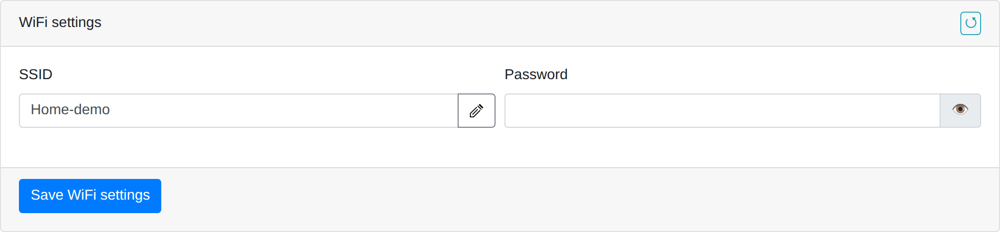
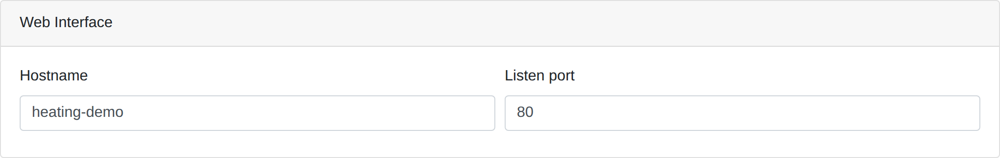
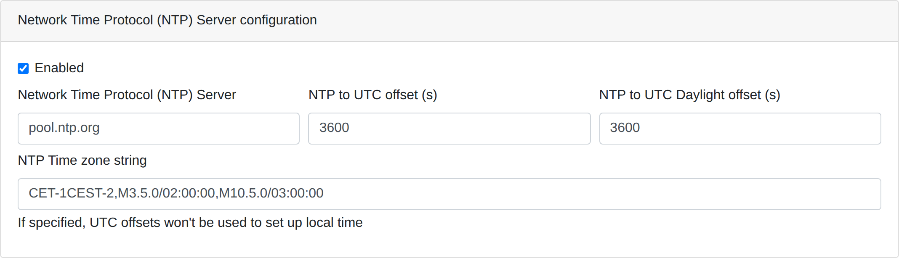
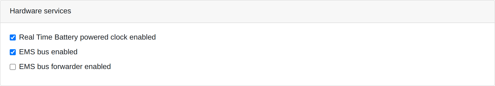
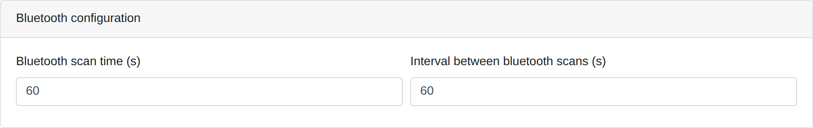
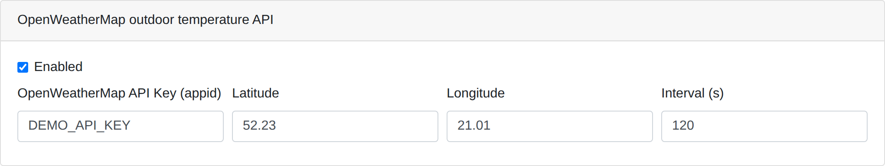
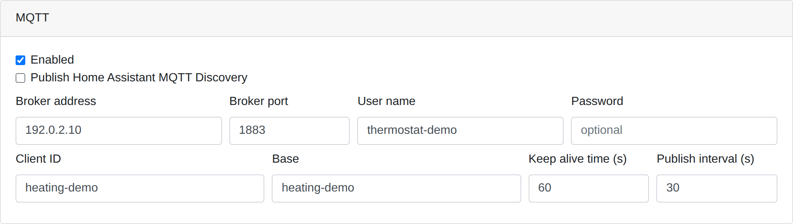
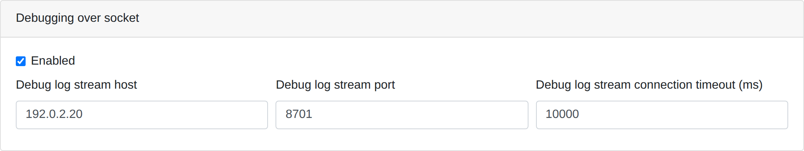
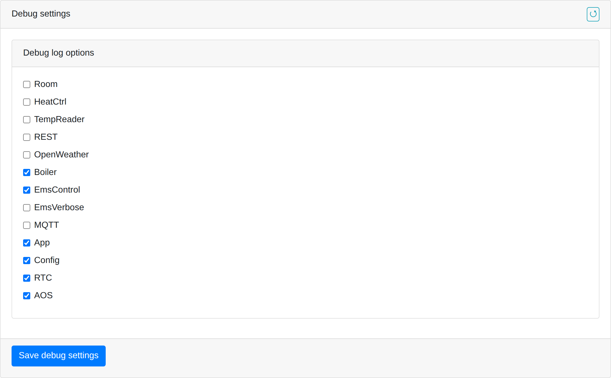

# Network and services

Open **Settings → Network and services**. There are three independent save
buttons. **Save WiFi settings** saves network credentials, **Save settings** saves
all **Device settings** sections, and **Save debug settings** saves log categories.
The reload arrow in a section header fetches its saved configuration and can
replace unsaved changes.

Wi-Fi and device settings take effect after reboot; the UI offers a restart after
saving. Log-category changes apply immediately, although the UI also offers a
restart for them. Screenshots use example addresses, accounts and an illustrative
`DEMO_API_KEY`.

## Wi-Fi



Enter **SSID**, or use the button beside it to list detected networks. Choose a
network and click **Select network**, enter **Password**, then click **Save WiFi
settings**. Choosing an SSID in the dialog does not save it. Hold the eye icon to
reveal the password you entered.

The existing Wi-Fi password is not loaded into the form; enter it when saving
credentials again. After restart, the thermostat connects using the new settings.
Find its assigned IP address in your router's client list.

When the configured SSID is empty, firmware starts an access point using the
settings in `/cfg/cfgap.json`. Failure to connect to a saved network does not by
itself trigger this mode.

## Web interface address



**Hostname** sets the device name. **Listen port** sets the HTTP server port
(1–65535). After changing it and rebooting, include the new port in the URL,
e.g. `http://<thermostat-ip>:8080/`. Hostname resolution depends on your network;
setting a name here does not guarantee that every client can resolve it.

## Time, NTP and RTC



Room schedules use the thermostat's local time. If heating runs at unexpected
hours, compare **Time** on Home with your local clock first.

| Field | Purpose |
|---|---|
| `Enabled` under NTP | Synchronize time with a network server. |
| `Network Time Protocol (NTP) Server` | Server hostname or address, e.g. `pool.ntp.org`. |
| `NTP to UTC offset (s)` | UTC offset in seconds when no time-zone string is configured. |
| `NTP to UTC Daylight offset (s)` | Additional daylight offset when using numeric offsets. |
| `NTP Time zone string` | POSIX time-zone rules; take precedence over numeric offsets. |

The repository's Polish time configuration is
`CET-1CEST-2,M3.5.0/02:00:00,M10.5.0/03:00:00`. The field accepts POSIX rules,
not the IANA name `Europe/Warsaw`. The current UI marks this field as required.
Use rules appropriate to the installation.

**Real Time Battery powered clock enabled**, under **Hardware services**, enables
the connected physical RTC. Firmware reads it during startup and updates it after
NTP synchronization. Enable this option when the module is actually installed.

## EMS services



Under **Hardware services**, **EMS bus enabled** enables boiler communication.
Choose the boiler control mode separately in **Boiler and heating curve** and
configure RX/TX under **Hardware configuration**.

**EMS bus forwarder enabled** enables an additional interface for forwarding EMS
frames. It needs separate wiring and its own configured RX/TX pins.

## Bluetooth thermometers

The thermostat scans BLE advertisements and associates readings with rooms by
sensor address. It does not require pairing each sensor with the web interface.
The reader recognizes `MJ_HT_V1` advertisements and the supported format from
devices named `ATC_…`. Seeing a device in a generic Bluetooth scan does not
establish that its payload can be decoded. For Xiaomi thermometers, use a
firmware/advertising configuration matching one of these supported formats.

1. Place the thermometer within reception range and allow scanning to complete.
2. Open **Settings → Rooms and programs → Rooms** and select the room.
3. Click **Choose** beside **Temperature sensor**, select its BLE address, or
   enter the address manually.
4. Click **Save rooms**, then check the Home tile for temperature, humidity
   and battery readings when provided by the sensor.

A sensor already used by another room is marked in the chooser. When replacing
an AOS room's sensor, its learned model starts fresh.

The chooser's **Show sensors assigned to other rooms** checkbox makes those
addresses selectable. Confirm the chosen address with **OK**, then use **Save
rooms** to persist the assignment. Closing the chooser without confirming leaves
the previous address unchanged.

In **Network and services → Bluetooth configuration**, **Bluetooth scan time (s)**
is the duration of one scan. **Interval between bluetooth scans (s)** is the pause
from scan completion to the next scan. With both set to 60 seconds, a cycle takes
about two minutes. Long pauses can leave the controller without fresh readings;
its room average uses the last three minutes of samples.



For missing readings, check the BLE address, battery, reception, advertising
format and scan timing. `TempReader` logging helps distinguish received packets
from successful temperature decoding.

## OpenWeather



Select **Enabled**, supply your **API Key (appid)** and **Latitude**/**Longitude**.
**Interval (s)** controls polling; the form accepts 60–600 seconds. Click **Save
settings** and restart.

Available data populates the weather tile. To use this outdoor temperature for
the heating curve, also select OpenWeather as **Outdoor temperature source** in
boiler settings. Enabling weather downloads alone does not change that source.

## MQTT and Home Assistant



Enable MQTT and configure the broker:

| Field | Purpose |
|---|---|
| `Broker address` / `Broker port` | Broker address and port, e.g. a local IP and 1883. |
| `User name` / `Password` | Credentials; leave blank if the broker does not require them. |
| `Client ID` | Client identity; use a different ID for each device. |
| `Base` | Topic prefix, e.g. `heating-demo`. |
| `Keep alive time (s)` | MQTT connection keepalive parameter. |
| `Publish interval (s)` | Interval between periodic telemetry publications. |
| `Publish Home Assistant MQTT Discovery` | Publish standard MQTT entity discovery configurations for HA. |

For base `heating-demo`, room telemetry uses `heating-demo/room_data`, availability
uses `heating-demo/status`, and EMS telemetry uses `heating-demo/ems_status`.
Home Assistant must use the same broker and topic base.

With this repository's custom **OpenThermostat** integration, leave **Publish Home
Assistant MQTT Discovery** disabled to avoid duplicate entities. State topics
continue publishing. Enable Discovery when using standard HA MQTT entities
without the custom integration.

Click **Save settings** and restart. For installation, dashboards, alerts and
room controls, see the [HA integration guide](../README.md#home-assistant-climate-panels).

## Diagnostic logging over TCP



**Debugging over socket** configures the destination of the thermostat's log stream:

- **Enabled** turns on log transport.
- **Debug log stream host** is the address of the computer receiving logs.
- **Debug log stream port** is its listening port, e.g. 8701.
- **Debug log stream connection timeout (ms)** limits connection attempts,
  e.g. 10000 milliseconds.

The thermostat connects to the receiver. Entering the thermostat's own address
does not start a log server. A receiver must be listening on the destination
computer. Save transport settings with **Save settings** and restart.



Under **Debug settings → Debug log options**, select categories and click **Save
debug settings**. The running firmware supplies this list, so it may differ from
the example. Categories select log content; they do not enable the TCP transport.

| Category | Useful for |
|---|---|
| `TempReader`, `Room`, `HeatCtrl` | BLE readings, room regulation and shared heating decisions. |
| `Boiler`, `EmsControl`, `EmsVerbose` | Boiler control and EMS communication. |
| `MQTT`, `OpenWeather`, `REST` | Service connections and API handling. |
| `App`, `Config`, `RTC` | Startup, configuration and clock operation. |
| `AOS` | Thermal learning, forecasts and warmup observations. |

For AOS capture, run the repository's receiver on the configured destination:

```sh
python3 tools/capture_device_log.py --port 8701 --device <thermostat-ip> \
  --output logs/aos-night.log
```

Leave it running during observation and stop with Ctrl+C. Use one receiver per
port. Enabling `AOS` logging does not enable thermal learning in rooms; configure
that separately under **Rooms**. See [AOS diagnostics](ADAPTIVE_OPTIMAL_START.md)
for record formats and analysis.

## Saving and troubleshooting

The current UI validates the entire network form when saving Wi-Fi or device
settings. A missing Wi-Fi password or another required field can therefore block
**Save settings** while editing MQTT. Fill the highlighted field. The buttons
still save separate configurations: **Save settings** does not save the Wi-Fi
password; use **Save WiFi settings** for that.

If the UI becomes unreachable after restart, check the SSID, IP and HTTP port.
For missing HA readings, check MQTT enablement, broker credentials, base and
client ID. For missing AOS decisions, check room settings, local time and fresh
sensor readings before investigating logging categories and transport.
