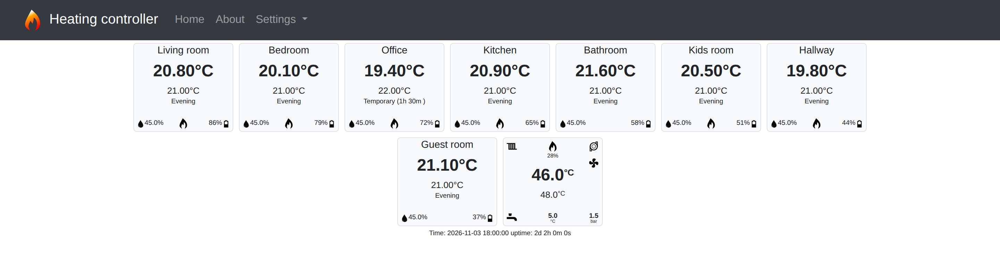
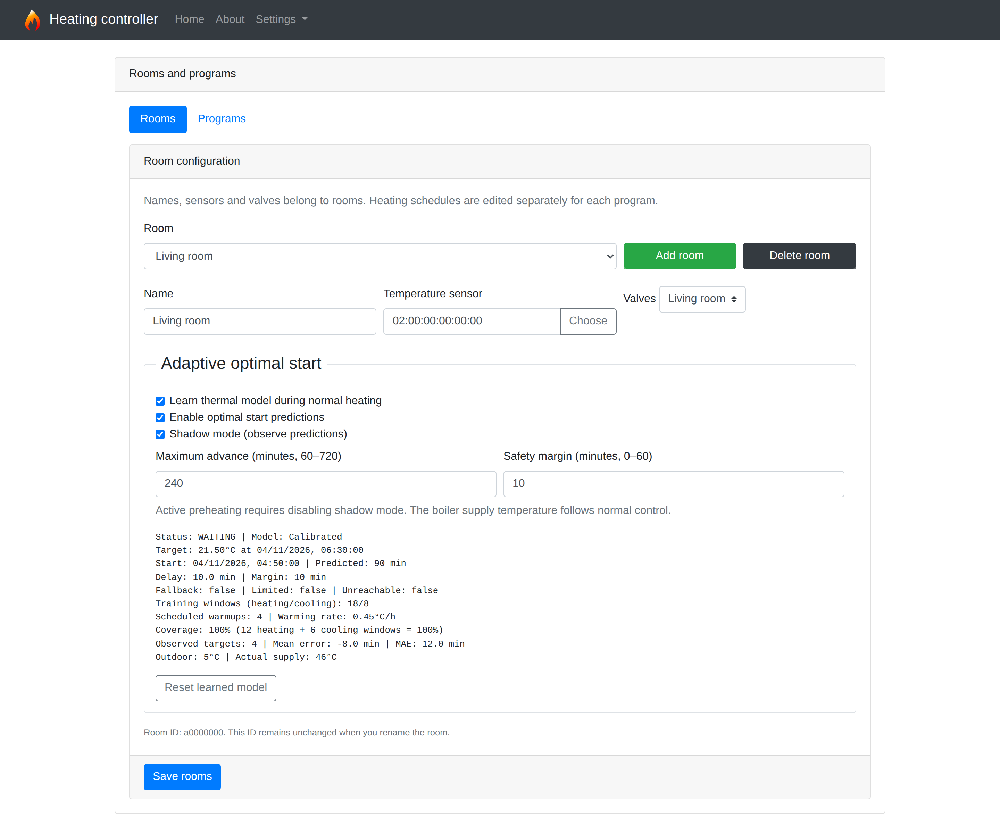
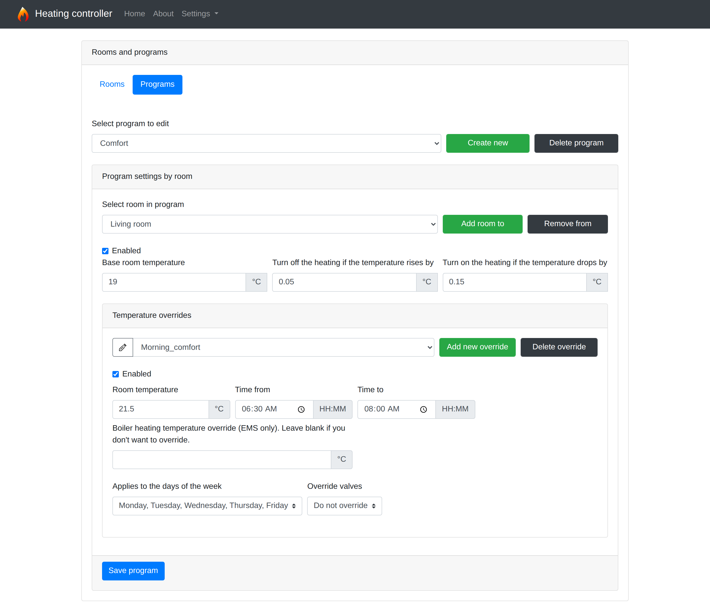
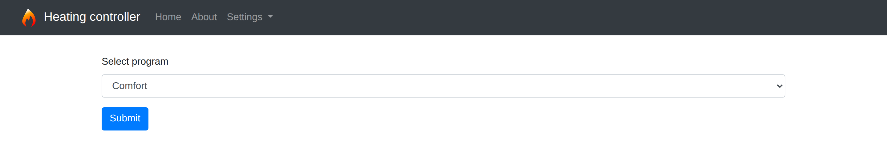
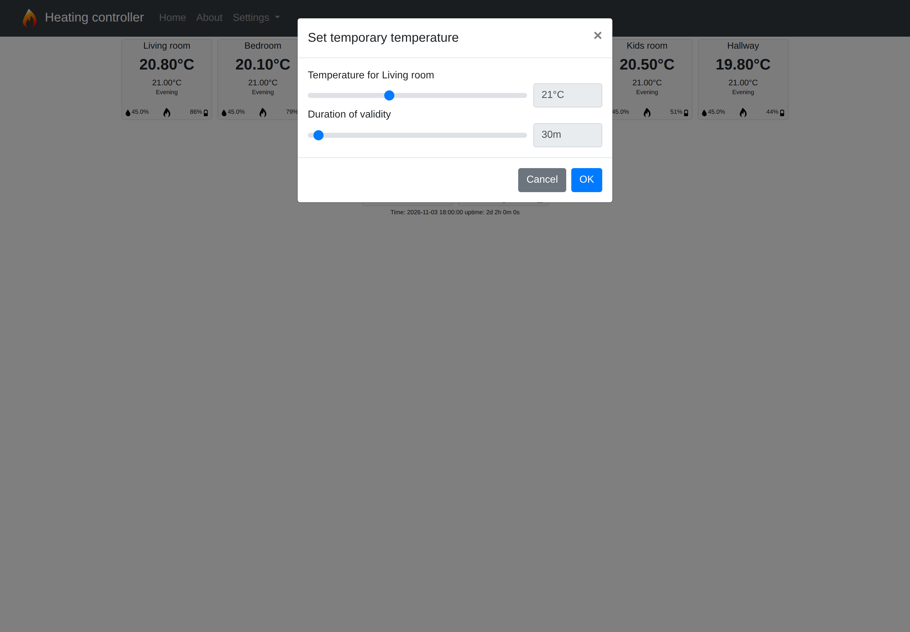
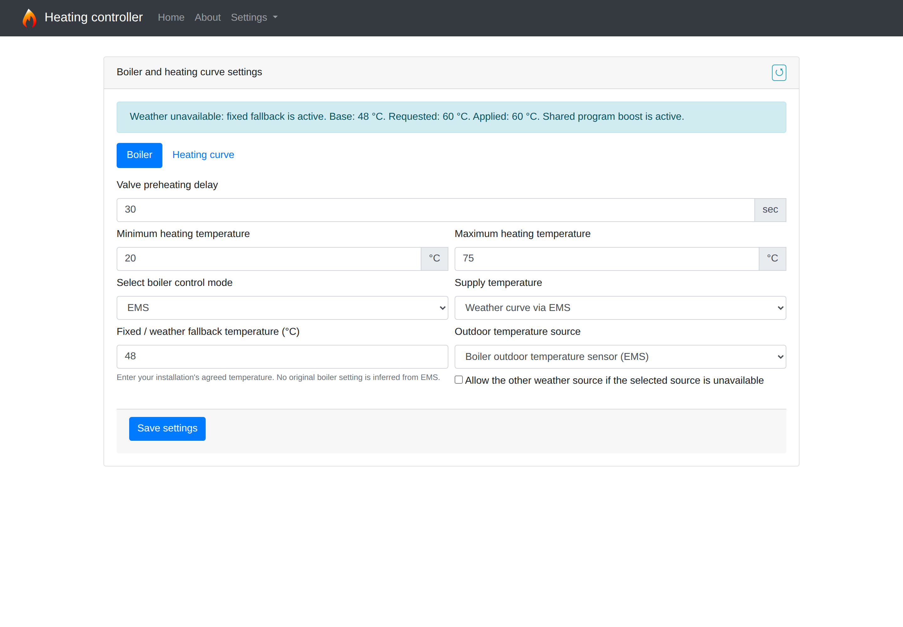
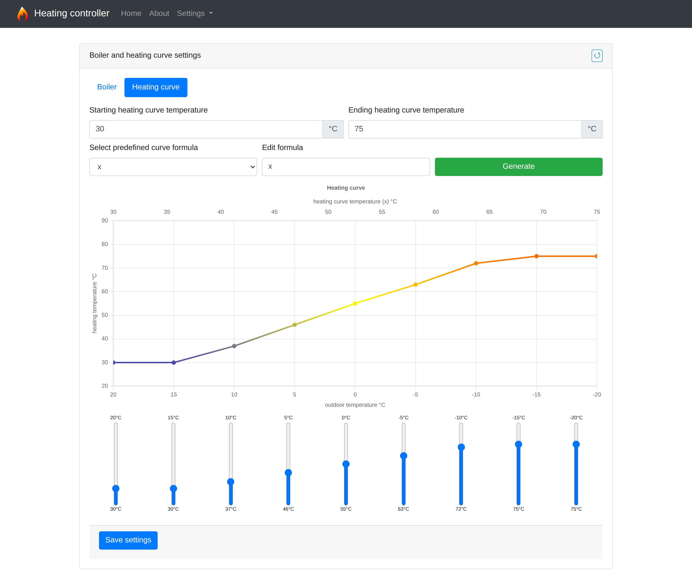
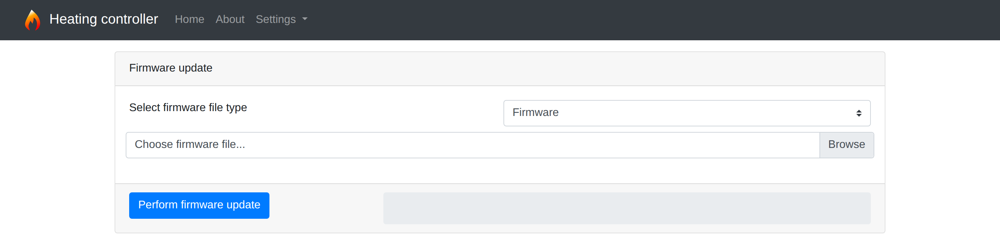

# User guide

Open the thermostat's IP address in your browser. The screenshots show example
rooms and readings. Use [Network and services](NETWORK_AND_SERVICES.md) to set
up connectivity and thermometers, and [Circuits and I/O](CIRCUITS_AND_IO.md) to
configure physical outputs before assigning them to rooms.

## Home screen

Each room tile shows the measured temperature in large text, followed by the
target temperature and the matching schedule override or main program name.
`Temporary` includes the remaining override time. `Optimal start` indicates
active AOS preheating. Humidity, battery level and heating state appear below.

The flame means that the room requests continued heating and the boiler is
started. It does not independently confirm flow through that radiator. A power
icon marks a room disabled in the current program. A missing temperature field
appears as `-`. The page refreshes every ten seconds.

After previously received samples become stale, the current firmware can report
an unavailable average as `0.00°C` instead of omitting it. Do not interpret this
as a confirmed freezing room; check sensor reception and freshness as well.

With EMS enabled, the boiler tile displays actual and selected temperatures,
burner power, pressure, and pump, burner, space-heating and hot-water states.
During domestic hot-water operation it displays hot-water temperatures.
Available readings depend on the boiler. An OpenWeather tile appears when
weather data is available.

## Rooms and programs

A **room** defines its name, BLE sensor, assigned valve outputs and AOS settings.
A **program** defines independent temperatures, hysteresis margins and weekly
overrides for its rooms. Changing a room's name or sensor affects all programs;
changing its temperatures in one program affects only that program.

Each room has a permanent eight-character ID. Programs reference this ID, so
renaming a room preserves its identity. The device stores the room catalog in
`/cfg/rooms.json` and programs in `/programs/<name>.json`.

### Add a room

1. Open **Settings → Rooms and programs → Rooms** and click **Add room**.
2. Enter its name and BLE sensor address. **Choose** lists detected sensors;
   sensors assigned to other rooms are marked.
3. Select the valve outputs that belong to the room. Their labels come from
   **Hardware configuration**. One room can use multiple outputs.
4. Click **Save rooms** to persist the room catalog.
5. Open **Programs**, choose a program and click **Add room to program**.
   A new program entry starts with heating disabled; enable it and save.

Before deleting a room, remove its entries from all programs. **Remove from
program** only removes settings from the selected program. **Delete room**
removes the room from the catalog and immediately attempts to save; the server
rejects deletion while a program still references that room.

### Create and edit programs

In **Settings → Rooms and programs → Programs**, **Select program to edit**
chooses the configuration to edit. Selecting it here does not activate it.

Click **Create new program** and enter its name. Select **Clone selected program**
to copy the current program, or leave it unchecked to create an empty program.
Creation immediately saves the new program. Use **Save program** for subsequent
changes. The UI does not allow deletion of `default`.

| Room setting | Meaning |
|---|---|
| `Enabled` | Include this room in heating control for this program. |
| `Base room temperature` | Target when no weekly override matches. |
| `Turn off … rises by` | Upper margin above the target. |
| `Turn on … drops by` | Lower margin below the target for starting heating. |
| `Temperature overrides` | Named time/day intervals replacing the base target. |

Programs keep independent values. Saving the active program reloads its
configuration immediately; a device restart is unnecessary.

### Activate a program

Open **Settings → Change active program**, select the program and click
**Submit**. Names such as `Comfort`, `Away` and `Work_from_home` are labels;
they have no special built-in behavior. This page does not provide a calendar
for switching main programs. Weekly scheduling is configured inside overrides.

## Weekly temperature overrides

In the program editor, select a room and click **Add new override**. New overrides
start disabled. Set the target, **Time from**, **Time to**, weekdays and **Enabled**,
then click **Save program**. New override names accept ASCII letters, digits,
underscores and hyphens.

Use the pencil button beside the override selector to rename the selected entry.
**Delete override** removes it after confirmation; click **Save program** to
persist either change. Unchecking the override's **Enabled** keeps it saved but
excludes it from schedule selection.

For example, use a 19°C base target, `Morning_comfort` at 21.5°C from 06:30 to
08:00 on weekdays, and `Evening` at 21°C from 16:00 to 22:00 every day.
Without AOS, heating reacts to the higher target at the interval's start;
06:30 is not a guarantee that the room has already reached 21.5°C.

The current firmware applies these rules:

- A matching enabled override replaces the base target, even when it is lower.
- When intervals overlap, the **highest room temperature wins**, regardless of
  list order. Equal temperatures retain the first match, including its optional
  boiler supply override.
- Both endpoints are inclusive. An override ending at 08:00 still applies during
  that minute; the base resumes at 08:01 unless another override matches.
- Equal start and end times mean a single minute, not a full day.
- An overnight interval such as 22:00–06:00 uses the **current calendar day's**
  weekday selection. Selecting Monday matches Monday morning and Monday evening,
  rather than automatically extending into Tuesday. For one specific night,
  create Monday 22:00–23:59 and Tuesday 00:00–06:00 entries.
- In JSON, weekdays run from `0` (Sunday) to `6` (Saturday). Missing or empty
  `days` means all days. The UI requires at least one selected day.

**Boiler heating temperature override** requests boiler supply temperature in
EMS mode, not room temperature. Leave it blank to keep ordinary heating-curve
control. When enabled rooms have different active boiler overrides, the controller
uses the highest request. The request raises supply when necessary; it is not a
way to lower supply below the configured base temperature. Requests are bounded
by the minimum and maximum heating temperatures.

**Override valves** stores an exception-specific output selection. The current
firmware reports that selection in room status, but physical valve control uses
the room's main valve list. Do not rely on it to isolate a radiator for towel
drying. See [valve behavior](CIRCUITS_AND_IO.md#how-valves-behave).

## Temporary temperature

Click a room tile on **Home**, select a temperature and duration, and click
**OK**. The temperature slider accepts 10–40°C in 0.1°C steps; the duration slider
accepts 10–720 minutes in ten-minute steps. **Cancel** or the close button dismisses
the dialog without applying it. A new temporary setting replaces the
previous one for that room.

Temporary temperature takes precedence over the schedule and suspends AOS
preheating. When it expires, the current schedule target resumes. Saved programs
are unchanged. Configuration reloads preserve the override in RAM; a firmware
restart does not restore it. A temporary room target does not remove an active
boiler supply override belonging to the current weekly schedule entry.

## How heating is controlled

The controller uses an average room temperature and separate start/stop margins.
For a 21°C target, 0.15°C lower margin and 0.05°C upper margin:

| Room temperature | Decision |
|---|---|
| Below 20.85°C | Request boiler startup. |
| From 20.85°C to below 21.05°C | Continue heating if the boiler is already running. |
| At least 21.05°C | No heat needed; assigned valves can be closed. |

The shared boiler starts when at least one enabled room requests startup.
A room in the middle range can receive heat while another room starts the boiler.

The average uses samples from the last three minutes. A last reading older than
five minutes is also considered stale. Without a valid average, the room does
not request startup or continued heating. Its valves remain open. Disabling a
room in a program also does not physically isolate its circuit: it can receive
heat while other rooms are heated.

## Boiler and heating curve

Open **Settings → Boiler and heating curve** to select the control mode,
outdoor-temperature source, supply-temperature limits and valve preheating delay.
Choose **Relay ON/OFF** or **EMS** for heating control, then choose the supply
policy separately. A relay can leave the water temperature at the **Boiler
setting**, or send a **Fixed temperature via EMS** or **Weather curve via EMS**
while switching heat through the relay. EMS heating control requires a fixed
or weather-based supply temperature; it cannot recover an original user setting
from a value previously written by this controller. Enable EMS in hardware
settings whenever supply commands use it.

The **Heating curve** tab defines water temperatures for outdoor temperatures
from +20°C to −20°C. It controls supply water, while room targets remain in
programs. Adjust the points with the sliders or generate them using a formula,
review the chart and click **Save settings**.

### Boiler controls and curve generation

| Control | Behavior |
|---|---|
| `Valve preheating delay` | Boiler startup delay in seconds to allow actuators to open; zero disables the delay. |
| `Minimum heating temperature` / `Maximum heating temperature` | Runtime bounds for both base supply and program overrides, also used by the curve editor. EMS commands and AOS forecasts use the same bounds and truncate interpolated temperatures to whole °C. |
| `Select boiler control mode` | Relay ON/OFF or EMS heating commands. Supply policy is selected separately. |
| `Outdoor temperature source` | EMS, OpenWeather or automatic EMS → OpenWeather. Available in every supply policy because AOS also uses the selected outdoor input for learning and forecasts. Enable the services separately. Readings must be fresh and between −60°C and +60°C. |
| `Supply temperature` | Boiler setting (plain relay only), fixed temperature via EMS, or weather curve via EMS. |
| `Fixed / weather fallback temperature` | Required for fixed and curve policies. Enter an agreed temperature within the heating limits. Used directly in fixed mode and when all permitted weather sources fail in curve mode. |
| `Allow the other weather source` | Explicitly allows a secondary source. Automatic source selection always permits EMS → OpenWeather; selecting OpenWeather otherwise keeps OpenWeather first. |
| `Starting heating curve temperature` / `Ending heating curve temperature` | Supply-temperature range used for formula generation and the chart's upper axis. |
| `Select predefined curve formula` | Copies a preset expression into `Edit formula`. |
| `Edit formula` / `Generate` | Evaluates an expression to replace the nine curve points in the editor. |
| Nine sliders | Adjust individual supply targets for +20, +15, +10, +5, 0, −5, −10, −15 and −20°C outdoors. |

The generator uses a reference `x` value for each of the nine points; `x` is not
the outdoor temperature. The current UI builds those references when the page
opens, from its initial 20–90°C fields. Loading saved settings or changing the
range does not rebuild them. Formula `x` uses those references; `1.2 * x`
multiplies them. Results are truncated to whole °C and clamped to the currently
selected start/end range. Selecting a preset or changing the range does not
itself save the curve; inspect the generated points first.

Firmware interpolates between saved points and uses the endpoint target outside
the outdoor range. The nine points are the actual saved curve, not the formula.
Boiler and curve settings share **Save settings** and take effect after restart;
the UI offers that restart after a successful save. The reload arrow restores
the saved boiler configuration, replacing unsaved edits.

When weather is missing, stale or invalid, the curve switches to the configured
fixed fallback. Fresh weather restores the curve on the next control cycle.
The settings status shows the reason, source, base temperature, requested
temperature and any applied shared program boost. The home screen also shows a
weather-fallback or configuration-required notice. An actual −20°C measurement
is valid; missing weather is never replaced by an invented measurement.

EMS outdoor readings expire after 30 minutes. OpenWeather readings expire after
twice the configured polling interval, bounded to 30–120 minutes; provider dates
are checked when the device clock is valid. Fixed supply needs no weather reading.

Existing `onoff` configurations retain boiler-controlled relay heating. Existing
`onoff_outdoor` and `ems` configurations retain curve control, source preference
and secondary-source fallback. Historical `outdoorSensor: "no"` retains the old
OpenWeather-first selection with EMS as secondary. Migration does not guess a
fixed temperature or use an EMS echo as the original setting. Until you save an
explicit fallback, loss of all weather data shows **Configuration required**:
relay control continues at the last written boiler setting, including any earlier
program boost, without a new temperature write. Whole-warmup calibration is
blocked while the ordinary supply baseline is unknown; basic learning from
measured supply continues. EMS heat is disabled until weather returns or a fixed
fallback is configured. An interrupted heating request is remembered while rooms
still request continued heating; recovery respects the valve startup delay.
Reaching the upper hysteresis threshold cancels that request. Save the agreed value
before relying on operation without weather. Settings take effect after reboot.

The saved `boiler` object adds `supplyMode` (`boiler`, `fixed` or `curve`),
`fixedSupplyTemperature` (whole °C) and `weatherFallback` (boolean).
`outdoorSensor` accepts `ems`, `owm` or `auto`. Transport values remain `onoff`
(boiler setting only), `onoff_outdoor` (relay with EMS supply commands) and `ems`.
For example, a curve configuration may specify `supplyMode: "curve"`,
`outdoorSensor: "owm"`, `weatherFallback: false` and
`fixedSupplyTemperature: 48`. The 48°C value is illustrative: choose the value
for your installation explicitly. The bundled legacy configuration does not
silently assign a fallback. API writes reject unsupported combinations, trailing non-JSON content and
out-of-range, fractional or missing required values before saving.

## Adaptive optimal start (AOS)

AOS searches the next twelve hours for an increase in a room's effective schedule.
It estimates warmup duration and can apply that higher room target early without
rewriting the saved schedule. It does not independently boost boiler supply or
bring a future boiler override forward into preheating.

In **Rooms**, settings belong to the physical room and apply across programs:

1. Enable **Learn thermal model during normal heating**.
2. Enable **Enable optimal start predictions**.
3. Keep **Shadow mode (observe predictions)** enabled while observing results.
   Predictions are displayed without changing heating.
4. Set **Maximum advance** (60–720 minutes, default 240) and **Safety margin**
   (0–60 minutes, default 10), then click **Save rooms**.
5. To enable actual preheating, disable shadow mode and save again.

Learning and scheduling are independent. You can learn without preheating or
freeze an existing model by disabling learning. After three completed ordinary
scheduled warmups, the model becomes `Calibrated`. Before that it can use a
physical model or fallback prediction; neither implies validated accuracy.

Completed warmups must satisfy the learner's duration, data-quality and confirmed
heat requirements. An applied shared boiler boost excludes
whole-warmup calibration in every room, including rooms without an override. A
request at or below the base supply does not count as a boost. Temporary overrides, manual tests,
missing data and active AOS preheating also interrupt that observation. Ordinary
boiler cycling is allowed. See the technical guide for the precise conditions;
not every temperature increase adds a calibration cycle.

| Status | Meaning |
|---|---|
| `DISABLED` | AOS prediction disabled. |
| `NO_DATA` | Insufficient valid input for a decision. |
| `NO_EVENT` | No upcoming temperature increase in the search horizon. |
| `OVERRIDE` | Temporary room target active. |
| `WAITING` | Waiting for the calculated start. |
| `SHADOW` | Proposed start reached; ordinary heating remains unchanged. |
| `PREHEATING` | The early target is being applied. |

Room diagnostics show target and start times, forecast, delay, training windows,
completed warmups, coverage and observed errors. `Fallback` indicates an
alternative prediction method; `Limited` indicates constrained advance;
`Unreachable` means the model cannot reach the target within its horizon.
Coverage is a training-data counter, not a confidence guarantee.

Models are persisted in NVS and tied to room ID and sensor address. Renaming a
room preserves its model; changing the sensor starts a fresh one. **Reset learned
model** immediately removes the model from RAM and NVS after confirmation.
Up to eight rooms can opt into AOS learning or prediction; this is separate from
the number of configured heating circuits.

Technical schedules such as short high targets for towel drying also look like
comfort increases to AOS. There is no per-override AOS exclusion. Keep predictions
disabled or shadow mode enabled for such rooms. See the
[AOS technical documentation](ADAPTIVE_OPTIMAL_START.md) for model details.

## Hardware, updates and integrations

- [Circuits and I/O expanders](CIRCUITS_AND_IO.md) explains physical output
  configuration and **Manual I/O Test**.
- [Network and services](NETWORK_AND_SERVICES.md) covers Wi-Fi, Bluetooth
  thermometers, time, MQTT, weather and logging.
- **About** identifies the project and libraries used by the web interface.
- The [Home Assistant integration](../README.md#home-assistant-climate-panels)
  provides room thermostats, diagnostics, dashboards and alerts. Changing a target
  in HA creates a temporary override.

### Firmware and filesystem updates

Open **Settings → Firmware update**. Select **Firmware** for `firmware.bin` or
**SPIFFS** for the filesystem image, choose the file, and click **Perform firmware
update**, subject to the hardware support below. The image must match the device hardware and partition layout. The
progress bar shows upload progress; wait for the success response before accepting
the offered restart. An interrupted connection does not confirm a successful update.

| Current hardware layout | Firmware update | SPIFFS update |
|---|---|---|
| `esp32s3`, dual application slots | Web UI or USB | Web UI or USB |
| `esp32dev`, single factory application | USB only | Web UI or USB |

The firmware option is still visible on `esp32dev`, but uploads fail with
`OTA partition not found`. Use `pio run -e esp32dev -t upload` over USB instead.
An older S3 partition layout must first be migrated over USB as described in
[filesystem OTA](../README.md#filesystem-ota).

A filesystem image replaces UI **and configuration files**; it does not preserve
the running device's settings automatically. Export and incorporate the existing
rooms, programs, service settings and output mapping before building it. Record
Wi-Fi credentials separately because the Wi-Fi GET endpoint omits the password.
Follow [configuration preservation](../README.md#preserve-configuration-before-a-filesystem-update)
before either web or USB filesystem upload.
